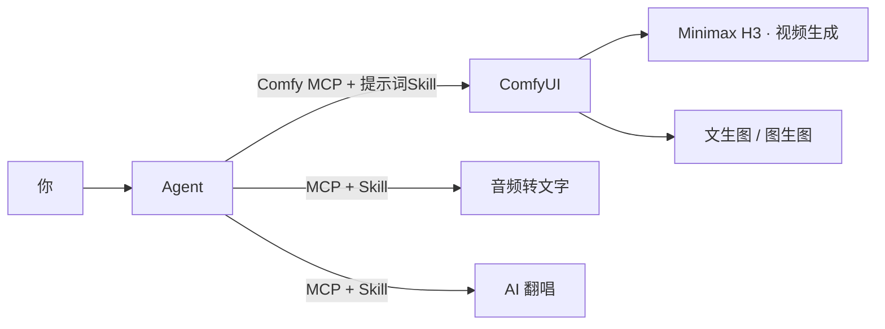
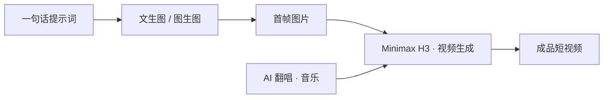

# 武装你的 Agent

诡锋 · 第一期杂谈

🔌 给 Agent 接上各种工具，让它变成一个什么都能干的助手

2026-10-11

<!--
【开场】

大家好，我是诡锋。欢迎来到我的第一期杂谈。

这一期我想聊的东西，一句话就能说清楚：
怎么给 Agent「装上装备」，让它从只会聊天，变成一个什么工具都能调用、什么活都能干的万能助手。

不讲原理，不讲论文，只讲一套我自己在用的做法。
-->

---
glow: bottom-left
---

# 目录

<v-clicks>

1. **确定需求** —— 先想清楚要做什么，再谈工具
2. **工具选型** —— 功能软件主体 + 各种 MCP + 各种 Skill
3. **自动化实现及测试** —— 懒一点，全权交给 Agent
4. **流程固化** —— 写成一篇文档，让 Agent 照着流程走

</v-clicks>

一条主线贯穿到底：**Agent 接入工具 → 变成万能 Agent**。

<!--
今天的路线很简单，就四步：
先确定需求，再选工具，然后交给 Agent 去实现和测试，最后把流程固化下来。
每一步我都会用自己的例子来讲，不讲空话。
-->

---
layout: section
glow: top-right
---

PART 01

# 确定需求

<!--
第一步，也是最容易被跳过的一步：确定需求。
很多人一上来就问「我该装哪个工具」，结果装了一堆，一个都用不上。
我们反过来——先把「要干什么」说清楚。
-->

---
glow: bottom-right
---

# 先想清楚：要做什么

别一上来就挑工具， 
先回答一句：<b>我到底想让它替我干什么活？</b>

需求越具体，后面越好办。不是「我想要个 AI」，而是「我要它产出什么」。

<!--
关键就一句：先想清楚要做什么。
不是「我想要个 AI」，而是「我要它产出什么」。
需求定得越具体，后面的工具越好选。
-->

---
glow: full
---

# 我的一串需求

我不想只做一件事，我想要一整套本地创作流水线。

🎬 视频生成

本地部署的 Minimax H3 工作流

🎧 音频转文字

录音、视频音轨 → 文本

🎤 AI 翻唱

换一副嗓子，唱同一首歌

🖼️ 图生图

拿一张图，改出另一张

还有 ✏️ 文生图 —— 以及，你能想到的各种本地工具。

<!--
拿我自己举例。我列了一串想要的能力：
视频生成——用本地部署的 Minimax H3 工作流；
音频转文字——把录音或者视频里的音轨转成文本；
AI 翻唱——给一首歌换一副嗓子；
图生图、文生图——这是大家最熟的了。
看起来是好几件事，对吧？但下一页你会发现，它们其实是一回事。
-->

---
glow: bottom
---

# 拆开看，其实是同一件事

每一个需求，本质都是：<b>一份输入进去，一份结果出来</b>。

我的输入

→

本地工具的产出

差别只在「用哪个工具」—— 而这一步，正好可以交给 Agent 去选、去接。

<!--
把每一个需求拆开看，你会发现它们都长一个样：
一个输入进去，一个结果出来。
文生图是「一句话进，一张图出」；音频转文字是「一段音频进，一段文本出」。
差别只在于中间用哪个工具。
而这，恰好就是 Agent 能帮我们搞定的事——它能判断该用哪个工具，并且把工具接起来。
-->

---
layout: section
glow: top-left
---

PART 02

# 工具选型

<!--
需求清楚了，第二步：给这些需求挑工具。
原则很简单——能抄作业就别自己写。用现成的工具，用现成的接入方式。
-->

---
glow: full
---

# 选型就一个原则

不造轮子 —— <b>用现成工具 + 现成接法，没有的再考虑开发</b>

🧱 能力

挑一个真正能干这活的「引擎」

🔌 接入

找它现成的 MCP，把 Agent 接上去

📖 说明书

没有 MCP，就给它配一份 Skill

<!--
选型我只认一个原则：不造轮子。
拆成三件事：先找一个真能干活的引擎；
再找它现成的 MCP，把 Agent 接上去；
如果它没有 MCP，那就给它配一份 Skill，当说明书用。
-->

---
glow: bottom-right
---

# 以ComfyUI为例

引擎

ComfyUI

本地跑各种生成工作流

接入

Comfy MCP

让 Agent 能操作 ComfyUI

说明书

各种 Skill

补齐 MCP 覆盖不到的 CLI 工具

ComfyUI 负责干活，Comfy MCP 负责接管，Skill 负责查漏补缺。

---
glow: center
---

# 接上之后，长这样

---
glow: bottom-left
---

# Skill：Agent老是走弯路？直接教会她！

    Agent不知道干啥的时候，给它写一份 Skill 当说明书。

  
帮我生成一个xxx的图片，然后和yyy, zzz组成图片1，2，3，然后帮我写一段Minimax H3提示词，剧情为...

  
Agent收到。先调用Qwen Image工作流生成图片，然后再到Minimax H3工作流生成视频。

Skill 不写死步骤，只告诉 Agent：有哪些工具、怎么调、哪些坑别踩。

---
layout: section
glow: top-right
---

PART 03

# 自动化实现及测试

---
glow: full
---

# 懒一点，全权交给 Agent

你实在是懒的话， 
可以把它该装的、该跑的、该测的，<b>一股脑全丢给它</b>。

你要做的，只有一句话：<b>「帮我安装下xxx」</b>

<!--
如果你实在懒——我也是——那就干脆全权交给 Agent。
工具安装、项目部署，甚至测试，都可以丢给它。
你要做的只有一句话：帮我把它装好、跑起来，然后自己测一下。
剩下的它自己会安排。
-->

---
glow: bottom-right
---

# 它主要能替你干的事

01

📦 装工具

拉依赖、配环境、起服务

02

🚀 部署项目

把工作流和项目放到该在的位置

03

🧪 自己测试

跑一次推理，看输出对不对

此外，你能想到的各种杂活，比如改docx文档等，就算你没有配skill，mcp，Agent也可以直接操作你的界面，它会通过截图的方式识别当前画面内容，然后精准操控你的电脑，只是消耗的Token数有所区别。

---
layout: section
glow: bottom
---

PART 04

# 流程固化

---
glow: full
---

# 写一篇文档，作为你的工作流

把「第一步产出什么、第二步拿它当输入」 
写成一篇文档，<b>Agent 就会照着它自动往下走</b>。

文档 = 你的工作流说明书。写清楚每一步的 <b>输入</b> 和 <b>输出</b>，Agent 就能自己把它们串起来。

<!--
做法特别简单：写一篇文档，当成你的工作流说明书。
说清楚每一步——前面产出什么、后面拿什么当输入。
写清楚之后，Agent 就会照着这篇文档，自动调用你已经接好的工具，一步接一步往下走。
你以后只要提一句「按流程来」，剩下的它自己会串。
-->

---
glow: center
---

# 一个例子：文生图 → Minimax H3

文生图 / 图生图的输出，直接作为 Minimax H3 的输入 —— 中间不用你手动搬运。

<!--
举个具体的例子，也是我自己的流程。
一句话提示词，先进文生图或者图生图，产出一张首帧图片；
这张图片直接喂给 Minimax H3 做视频生成；
再配上 AI 翻唱出来的音乐；
最后合成一条成品短视频。
注意中间那一步——文生图的输出，就是 H3 的输入。
这条链路我写进文档里，Agent 就会自己按顺序调用，中间不用我手动搬来搬去。
-->

---
glow: bottom-right
---

# 固化之后

🗣️ 你只提需求

「帮我做一条 xxx 主题的短视频。」

🤖 Agent 自动跑流程

按文档依次调用文生图 → 翻唱 → H3，产出成品。

工具接好了、流程写好了 —— 你就从「操作员」变成了「提需求的人」。

<!--
固化之后是什么体验？
你只说一句：「帮我做一条 xx 主题的短视频。」
然后 Agent 自己按文档往下跑：先文生图，再翻唱，最后 H3 合成，把成品交给你。
你就从一个一步步操作的人，变成了一个只提需求的人。
-->

---
layout: section
glow: bottom
---

结语

# 总结

<!--
最后，把整套做法收一下。其实就是四步。
-->

---
glow: full
---

# 四步，把 Agent 武装起来

01

定需求

先想清楚要产什么

02

选工具

ComfyUI + MCP + Skill

03

交给它

装、部署、自测

04

固流程

写成文档，自动调用

工具越接越多，Agent 就越万能 —— 而你的活，越干越少。

<!--
四步走：
一，定需求，先想清楚要产出什么。
二，选工具，ComfyUI 加 MCP 加 Skill。
三，交给 Agent，装、部署、自测。
四，固流程，写成文档，让它自动调用。
工具接得越多，Agent 就越接近「万能」。而你要干的活，越来越少。
-->

---
layout: statement
glow: center
---

# 工具是它的装备
# 流程是你的兵法

把重复劳动交给 Agent —— 你负责当那个提需求的人。

<!--
送大家两句话：
工具，是 Agent 的装备；流程，是你写的兵法。
把重复劳动统统交出去，你只负责当那个提需求的人。
-->

---
layout: end
glow: bottom
---

# 谢谢大家

剩下的，就交给大家，自行发挥创造力了。

<!--
【停顿，收】
剩下的，就交给大家，自行发挥创造力了。
谢谢大家。我们下期再见——如果我勤快的话。
-->
